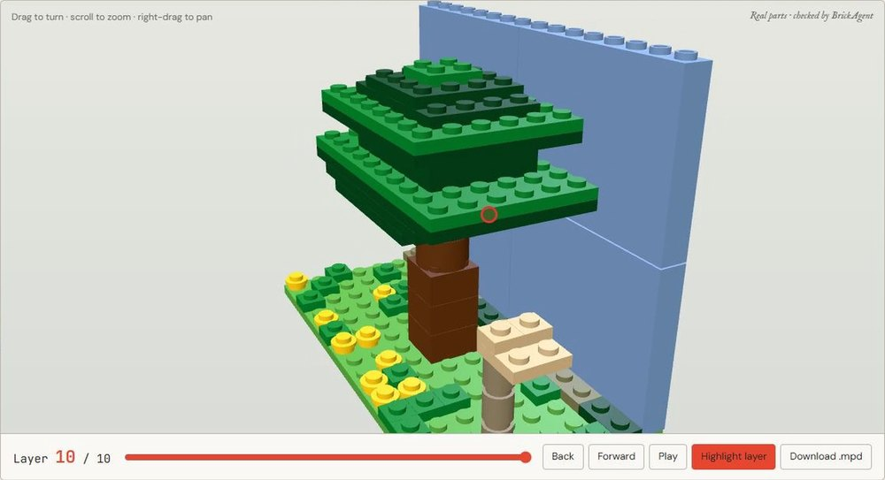
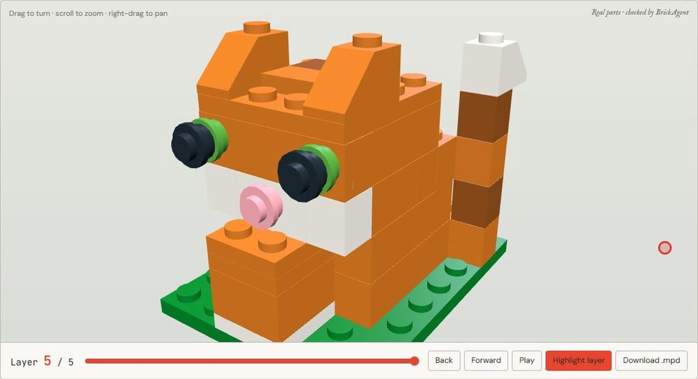
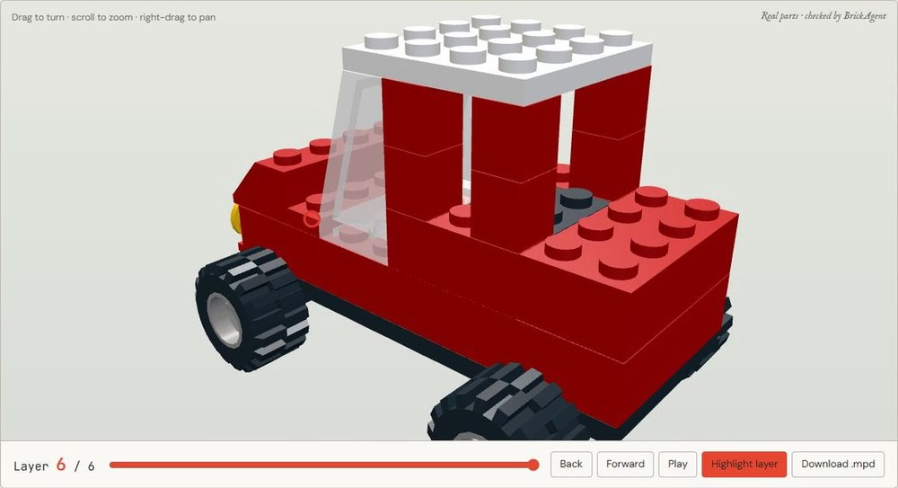
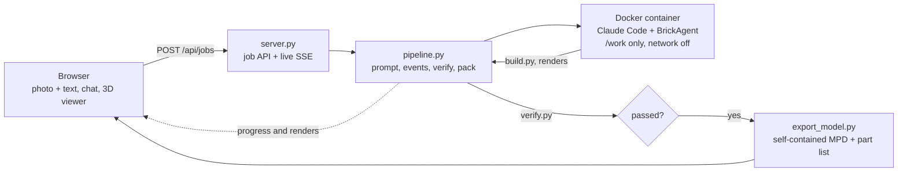

<h1 align="center">BRICKFORM</h1>

<p align="center">
  <b>Photo in, buildable LEGO out.</b><br>
  An agent that turns a photo or a sentence into a LEGO model built from real parts, and proves it holds together.
</p>

<p align="center">
  
  
  
  
  
</p>

<p align="center">
  
  &nbsp;&rarr;&nbsp;
  
</p>

## What it does

- **From a photo or a sentence to a model.** Upload a picture, write one line ("an orange cat", "make it a car"), or both.
- **Real parts, checked.** Every model is assembled from real LDraw parts and has to pass collision and physics checks before it counts as done.
- **Explore it.** Turn it with the mouse, replay the build layer by layer, and read the part list with LDraw numbers and quantities.
- **Keep talking to it.** "Make it red", "bigger", "lose the tail" edit the build the agent already made instead of starting over.
- **Watch it work.** The page streams the agent's progress and its own renders live, so a few minutes of generation never looks like a hang.

<p align="center">
  
  
</p>

## The hard part: the model has to be legal

A model that looks right on screen can still be impossible to build: two parts occupying the same space, a part that clips to nothing, a tail floating in mid-air. BRICKFORM treats that as the core problem rather than a polish step.

- The agent works inside [BrickAgent](https://github.com/kulits/BrickAgent)'s environment: it searches a catalogue of real LDraw parts, places them through their connectors, and runs `check()` (collision detection plus a PyBullet physics test) on its own work.
- When a check fails, it reads the error, fixes the build and checks again, until the model passes.
- After the agent stops, the pipeline runs the official `verify.py` (part count, collisions, stability) itself, so the page never relies on the agent's word. "Checked" on the model card means that verifier passed.

## How it works



1. The browser scales the photo to a 1536 px JPEG and posts it with the text to `POST /api/jobs`.
2. The backend renders BrickAgent's own prompt template (`scripts/prompt.py`) and appends the product's side of the brief: the reference photo is at `/work/reference.jpg`, render as you go, write `card.json` at the end, reply in English.
3. Claude Code runs headless inside the `brickagent-claude` container. `/work` is the only place it can write, and the network is off (WebSearch, WebFetch, curl and wget are denied). Every PNG it writes appears on the page within seconds.
4. When it stops, the container runs the official `verify.py`, then `container/export_model.py`, which embeds every referenced LDraw part into the MPD and tallies the part list.
5. The page loads that self-contained MPD and splits it into build layers by the bottom face of each part. The browser needs no part library at all.

A follow-up in the chat reuses the same `/work` and the same session (`claude --continue`).

## Run it yourself

BRICKFORM reaches its model through a LiteLLM-compatible endpoint, so **you bring your own key and endpoint**. Nothing secret is in this repository.

```sh
cp .env.example .env     # then fill in your own values
python3 server.py        # http://127.0.0.1:8787
```

`.env` needs three values, the same ones the BrickBench runner uses:

| Variable | What it is |
| --- | --- |
| `LITE_LLM_KEY` | Your API key for the model endpoint |
| `LITE_LLM_URL` | The LiteLLM (or compatible) proxy URL |
| `AGENT_MODEL` | The default model, for example `anthropic/claude-sonnet-5-5` |
| `AGENT_SMALL_MODEL` | Optional. The model Claude Code uses for its small background tasks; defaults to `AGENT_MODEL` |

You also need:

- A checkout of [BrickAgent](https://github.com/kulits/BrickAgent) next to this repository (`../BrickAgent`, or set `BRICKAGENT_REPO`). Its `scripts/prompt.py` renders the prompt.
- A Python with `jinja2` for that script (`../brickbench-run/.venv/bin/python`, or set `PROMPT_PYTHON`).
- Two Docker images: `brickagent` (the official BrickAgent environment) and `brickagent-claude` (the same thing plus the Claude Code CLI).

In the page you can pick the size (Sketch about 80 parts, Standard up to 400, Large set 400 to 4000), the model, and the thinking level.

> **Heads up:** a clone does not run out of the box. The two images are built by hand today. A single-command setup is the next thing we want to add.

To look at the layout alone, run `python3 -m http.server 8788 --bind 127.0.0.1 --directory web` from the repository root and open `http://127.0.0.1:8788/`. That static preview has no generation API.

## Project layout

| Path | What it does |
| --- | --- |
| `server.py` | The page, the job API, the live SSE transcript |
| `pipeline.py` | Prompt assembly, container calls, event translation, verification and packing |
| `container/export_model.py` | Runs in the container: self-contained MPD plus part list |
| `web/index.html`, `web/app.js` | The product page: framing, chat, replay, part list, history |
| `web/classic.js` | The viewer look: hemisphere plus key light, a hairline seam between parts, layered replay |
| `web/vendor/` | BrickAgent's `viewer.js`, three.js's `LDrawLoader`, and three.js itself (r183), all MIT |
| `standalone.py` | Packs a finished job into one self-contained HTML file |
| `preview.py` | Exports the empty opening state as a standalone HTML file |
| `jobs/<id>/` | One conversation: `work/`, `packed.mpd`, `manifest.json`, `events.jsonl` (not committed) |

## Design notes

The cover is a Mondrian grid of LEGO bricks: the red "Starting a project", yellow "Your model" and blue "Model history" bricks jump to the studio, the result and the history, and a black "Showcase" brick opens the reference gallery.

Once a model loads, the history book records the job ID, name, part count and check result **in this browser only**. No private photos or MPDs are copied. The list keeps at most 30 entries, and once browser data is cleared or the server's job files are gone, those entries cannot be restored.

## Known limits

- A model takes about 2 to 10 minutes and roughly $0.3 to $2 in our runs, depending on the model, thinking level and size. The "large set" tier takes longer.
- Scoring (BrickBench's VQA/ELO evaluation) is not implemented: it needs a GPU we did not have. "Checked" means the collision and stability verifier passed, which is a real claim but a narrower one than "this looks like your cat".
- The checks are simulation: collisions and a physics test. We have not assembled the generated models from physical bricks.
- The server binds to `127.0.0.1` and has no accounts; anyone who can reach the port sees every job.

## Credits and licences

- [BrickAgent / BrickBench](https://github.com/kulits/BrickAgent) is the building environment and the prompt template. It is MIT licensed; see the licence in that repository.
- [three.js](https://threejs.org/) (r183) and its `LDrawLoader` are MIT licensed; their licence headers are kept in `web/vendor/`.
- Parts come from the [LDraw](https://www.ldraw.org/) library.
- The Showcase gallery holds nine static **reference builds, none of them generated by this site**. Eight are picked out of the [BrickBench teaser in BrickAgent's repository](https://github.com/kulits/BrickAgent/blob/master/docs/images/teaser_mosaic.avif) (MIT), shown by positioning the original image so one model fills each tile. The architectural model is Said Sürücü's [Ayasofya custom model](https://github.com/saidsurucu/lego-hagia-sophia), re-encoded locally as WebP and credited under CC BY 4.0 as its project asks.
- The tree photo above is by Vyacheslav Argenberg, via [Wikimedia Commons](https://commons.wikimedia.org/), CC BY 4.0.

## Team

Built at **DubHacks '26** (University of Washington) by Eric Cai and Ella Zhang.
